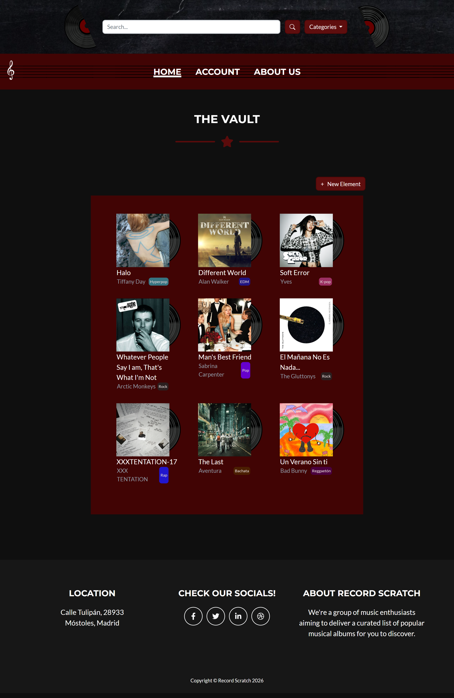
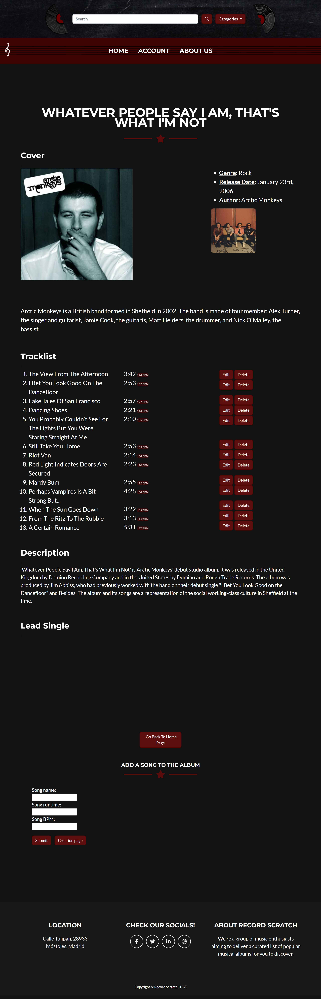
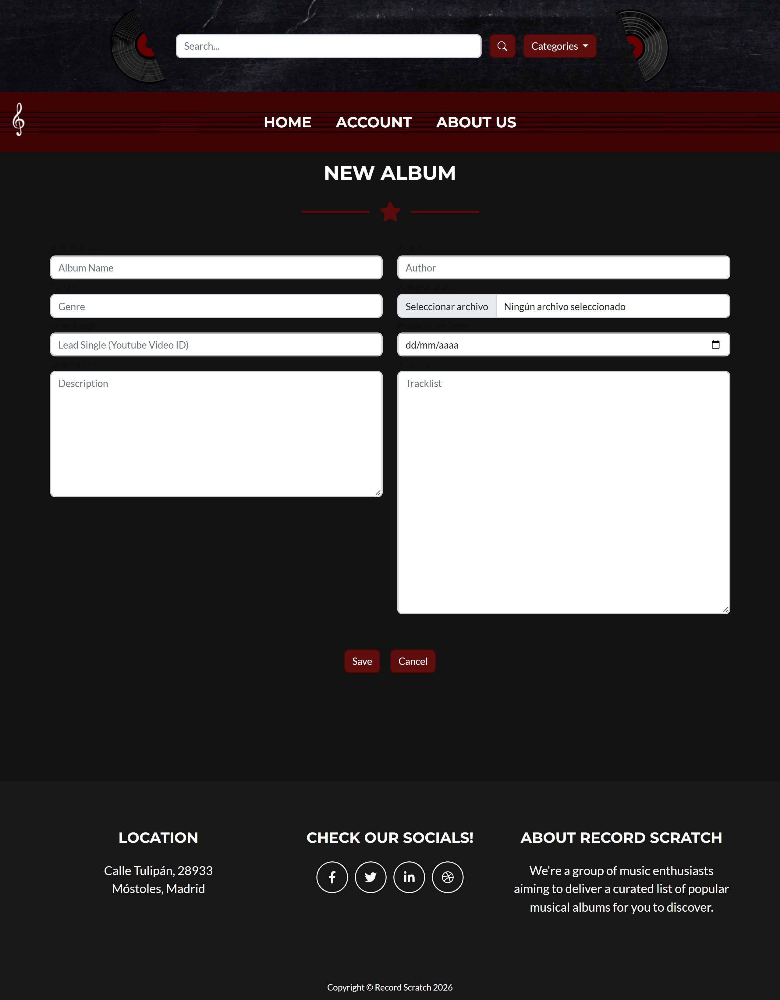

## Development Team
  * Adrienn Brinza | **mail:** a.brinza.2025@alumnos.urjc.es | **github:** aaddrii27-alt
  * Sofía Gómez García | **mail:** s.gomezga.2025@alumnos.urjc.es | **github:** sofiwagg
  * Eric Vela Pérez  | **mail:** e.velap.2025@alumnos.urjc.es | **github:** c4ndlee

## Summary
**RecordScratch** aims to be a web application designed to collect an archive of popular music throught the years in the format of **Albums**, each album contains **Songs**, and either of these can be **classified** following _Artist, Genre, Date of Release, etc._

The goal is to provide a curated list of albums across different genres with descriptions about the inspiration behind and information about the author, in order to nurture the user on music culture from a variety of perspectives and _sounds._

## Functionality

### Entities

* #### Main Entity | Albums 
  An Album consists of _7 attributes_:
  1. **Album Name:** The name of the album.
  2. **Album Cover:** An image of the album's cover art.
  3. **Description:** A description of the album's vision and inspirations, sometimes with details about the _making of_ and the _creative process_.
  4. **Tracklist:** The list of _songs_ contained in the album.
  5. **Lead Single:** A youtube videoplayer with the main single or most listened song on the album.
  6. **Genre:** The genre (or genres) the music on the album belongs to.
  7. **Author:** The author's name, photo and brief description.
  8. **Date of Release:** The _day, month and year_ the album was published on.

* #### Secondary Entity | Songs
  A Song consists of _4 attributes_:
  1. **Cover Art:** A image of the song's cover photo (or photos if multiple).
  2. **Runtime:** The duration of the song.
  3. **BPM:** The _Beats Per Minute_ (essentially the _rythm_) of the song.
  4. **Artists:** The author and (if any) featured artists' name, photo and brief description.

### Images
* **Albums:** Albums will feature an image for the _Album Cover_ and _Author_, as well and sometimes images from the album's _Photo Shoot_ (if any) or related to the album or any of the songs in it.
* **Songs:** Songs will feature an image (or images) for the _Cover Art_ and _Artists_.

### Search, filtering and categorization
Search queries may relate to the _Name of the Album_, _Name of the Author_, _Name of the Song_, _Name of the Genre_, _Date of Release_ or _BPM_, allowing the user to filter the search based on these preferences.

The data's categorization will be primarily organised as follows:

* Genre
  * Artist
    * Album
      * Song
## Participation in the workplace 

### Home Page

### Detail Page

### Creation Page

### Eric Vela Pérez
  * **Description:** I've created the index and home page, which includes the heading, footer, navigation bar and album grid. It also has a "Create New Element" button that links to the creation page. I made the album grid show the image in a vinyl record case style and also display the Title and Author of the album. At last, I've also added my 3 favorite albums to the grid.

  * **5 most important Commits:**
      * [Added title header](https://github.com/CodeURJC-FW-2026-27/webapp15/commit/9e7c2b8b1d768a6e071da477823f6faddea327db)
      * [Created navbar and added it to all pages](https://github.com/CodeURJC-FW-2026-27/webapp15/commit/05f83ece66ac5770e550efaddbd3bb3736be3981)
      * [Created album grid on home page](https://github.com/CodeURJC-FW-2026-27/webapp15/commit/5815b4f6def1eb4b74983e1597ed7a2580774f57)
      * [Made searchbar and filter button on Header and added it to all pages](https://github.com/CodeURJC-FW-2026-27/webapp15/commit/729c64cbc0903a604141e84ca50cbec62d8efc49)
      * [Made index record breaking animation smoother](https://github.com/CodeURJC-FW-2026-27/webapp15/commit/4d3ee4518a96e8a9edbfc975f1186805a162f900)
  * **Files I worked on:**
      *  [Index page](index.html)
      *  [Home page](home.html)
      *  [Detail page](detail_WPSIATWIN.html)
      *  [Creation page](detail.html)
      *  [Styles](styles.css)

### Sofía Gómez García
  * **Description:** I made the detail page, along with the detail page that shows an album as an example whenever you click any album in the home page. The detail page Shows the title of the album, its cover, specifications about the genre, release date and author; the tracklist along with each song's runtime and bpm, and a button to delete and edit each one as well; a description of the album and what it is about, a video of the album's lead single, a button to go to creation page, another button to go to home page, a form to add a new song to the album, and the footer. I have also added three albums to the home page.

  * **5 most important Commits:**
      *
      *
      *
      *
      *
  * **Files I worked on:**
    *  [Home page](home.html)
    *  [Detail Template page](detail.html)
    *  [Detail page](detail_WPSIATWIN.html)
    *  [Styles](styles.css)

### Adrienn Brinza
  * **Description:** I've created the detail page, which includes a form with 8 different fields and 2 buttons: one labeled “Save” (which has no function) and   another labeled “Cancel” that redirects you to the home page. I've also added my 3 favorite albums to the home page, each with its cover art and respective genre.      

  * **5 most important Commits:**
      *
      *
      *
      *
      *
  * **Files I worked on:**
    *  [Home page](home.html)
    *  [Detail page](detail_WPSIATWIN.html)
    *  [Creation page](creation.html)
    *  [Template Page](template.html)
    *  [Styles](styles.css)
