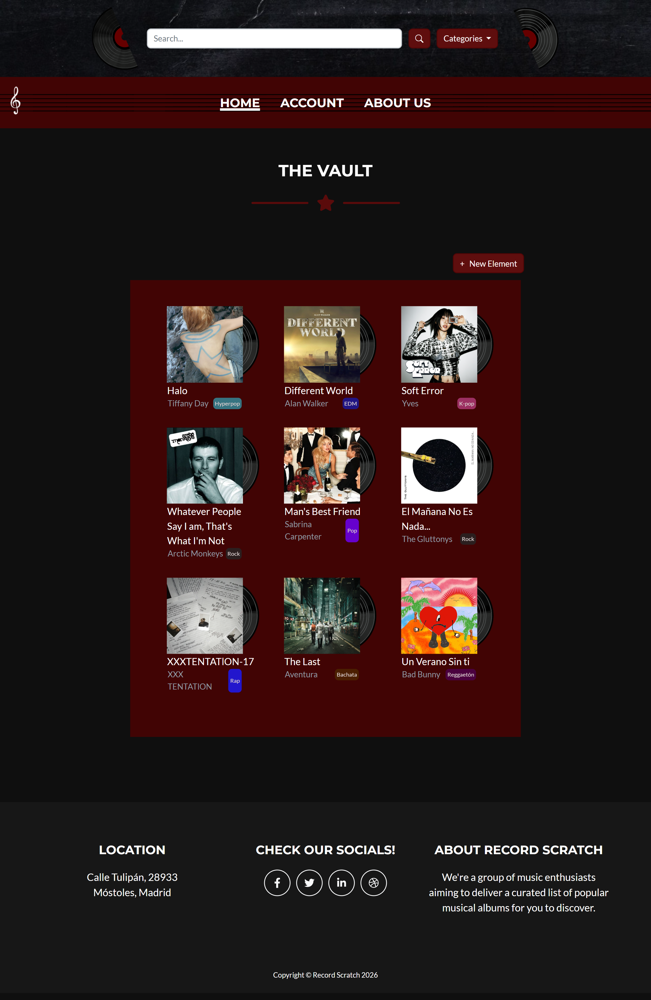
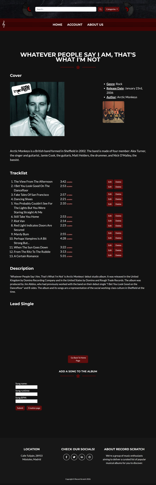
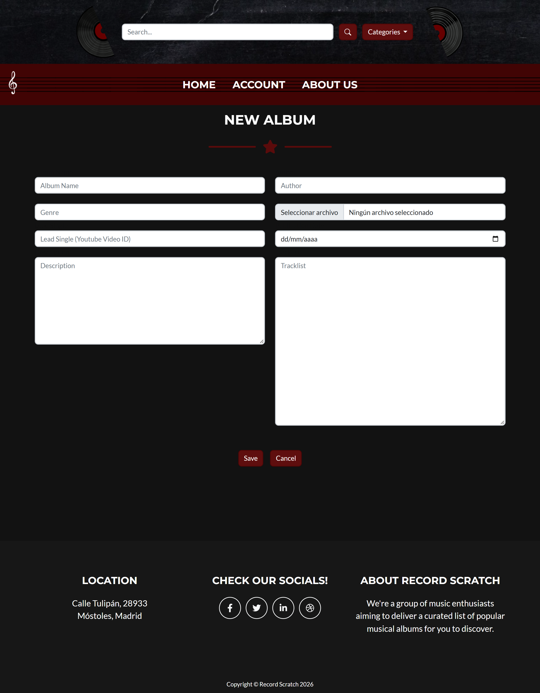

## Development Team
  * Adrienn Brinza | **mail:** a.brinza.2025@alumnos.urjc.es | **github:** aaddrii27-alt
  * Sofía Gómez García | **mail:** s.gomezga.2025@alumnos.urjc.es | **github:** sofiwagg
  * Eric Vela Pérez  | **mail:** e.velap.2025@alumnos.urjc.es | **github:** c4ndlee

## Summary
**RecordScratch** aims to be a web application designed to collect an archive of popular music throught the years in the format of **Albums**, each album contains **Songs**, and either of these can be **classified** following _Artist, Genre, Date of Release, etc._

The goal is to provide a curated list of albums across different genres with descriptions about the inspiration behind and information about the author, in order to nurture the user on music culture from a variety of perspectives and _sounds._

## Functionality

### Entities

* #### Main Entity | Albums 
  An Album consists of _7 attributes_:
  1. **Album Name:** The name of the album.
  2. **Album Cover:** An image of the album's cover art.
  3. **Description:** A description of the album's vision and inspirations, sometimes with details about the _making of_ and the _creative process_.
  4. **Tracklist:** The list of _songs_ contained in the album.
  5. **Lead Single:** A youtube videoplayer with the main single or most listened song on the album.
  6. **Genre:** The genre (or genres) the music on the album belongs to.
  7. **Author:** The author's name, photo and brief description.
  8. **Date of Release:** The _day, month and year_ the album was published on.

* #### Secondary Entity | Songs
  A Song consists of _4 attributes_:
  1. **Name:** The name of the song.
  2. **Runtime:** The duration of the song.
  3. **BPM:** The _Beats Per Minute_ (essentially the _rythm_) of the song.

### Images
* **Albums:** Albums will feature an image for the _Album Cover_ and _Author_, as well and sometimes images from the album's _Photo Shoot_ (if any) or related to the album or any of the songs in it.

### Search, filtering and categorization
The user can filter the search via the categories button next to the searchbar, where you can select music genre and date of release.

The data's categorization will be primarily organised as follows:

* Genre
  * Artist
    * Album
      * Song
    
## Práctica 1  

### Home Page

### Detail Page

### Creation Page

### Demonstration video
(https://youtu.be/lo0aLUm9iwU)

### Eric Vela Pérez
  * **Description:** I've created the index and home page, which includes the heading, footer, navigation bar and album grid. It also has a "Create New Element" button that links to the creation page. I made the album grid show the image in a vinyl record case style and also display the Title and Author of the album. At last, I've also added my 3 favorite albums to the grid.

  * **5 most important Commits:**
      * [Added title header](https://github.com/CodeURJC-FW-2026-27/webapp15/commit/9e7c2b8b1d768a6e071da477823f6faddea327db)
      * [Created navbar and added it to all pages](https://github.com/CodeURJC-FW-2026-27/webapp15/commit/05f83ece66ac5770e550efaddbd3bb3736be3981)
      * [Created album grid on home page](https://github.com/CodeURJC-FW-2026-27/webapp15/commit/5815b4f6def1eb4b74983e1597ed7a2580774f57)
      * [Made searchbar and filter button on Header and added it to all pages](https://github.com/CodeURJC-FW-2026-27/webapp15/commit/729c64cbc0903a604141e84ca50cbec62d8efc49)
      * [Created index landing page](https://github.com/CodeURJC-FW-2026-27/webapp15/commit/1099921e9c17a1626a6e9a281e7ee24546628cf6)
  * **Files I worked on:**
      *  [Index page](index.html)
      *  [Home page](home.html)
      *  [Detail page](detail_WPSIATWIN.html)
      *  [Creation page](detail.html)
      *  [Styles](styles.css)

### Sofía Gómez García
  * **Description:** I made the detail page template, along with the detail page that shows an album as an example whenever you click any album in the home page. The detail page Shows the title of the album, its cover, specifications about the genre, release date and author; the tracklist along with each song's runtime and bpm, and a button to delete and edit each one as well; a description of the album and what it is about, a video of the album's lead single, a button to go to creation page, another button to go to home page, a form to add a new song to the album, and the footer. I have also added three albums to the home page.

  * **5 most important Commits:**
      * [Created project files form template](https://github.com/CodeURJC-FW-2026-27/webapp15/commit/e50f708434dbf8fec9bc9afaf45f8052ef9ea885)
      * [Made changes in the distribution of detail page and added WPSIATWIN album](https://github.com/CodeURJC-FW-2026-27/webapp15/commit/9f6ee6275a4ebe57e665ae7bd1b34ac5e2aae294)
      * [Made the last changes in detail page and added albums to home](https://github.com/CodeURJC-FW-2026-27/webapp15/commit/9aa2c14bb8cec7df92b12ca10d322f09eb875161)
      * [Changed some details in detail pages](https://github.com/CodeURJC-FW-2026-27/webapp15/commit/d8ec57f6b8f8212f3472f20057e677a05f0a57e3)
      * [Added delete and edit buttons to each song in detail](https://github.com/CodeURJC-FW-2026-27/webapp15/commit/8f1bfc576a83cab56cf172eee48d8c085d560a08)
  * **Files I worked on:**
    *  [Detail Template page](detail.html)  [Home page](home.html)
    *  [Detail page](detail_WPSIATWIN.html)
    *  [Styles](styles.css)
    *  [Home page](home.html)
    *  [Creation page](detail.html)

### Adrienn Brinza
  * **Description:** I've made the creation page template, which includes a form with 8 different fields and 2 buttons: one labeled “Save” (which has no function) and   another labeled “Cancel” that redirects you to the home page. I've also added my 3 favorite albums to the home page, each with its cover art and respective genre.     
              
  * **5 most important Commits:**
      * [Introduction to all elements of the “Create” page](https://github.com/CodeURJC-FW-2026-27/webapp15/commit/10157cc7584c51a3aa768f4492c6ac65dbd135bb)
      * [Link the creation page to the main page](https://github.com/CodeURJC-FW-2026-27/webapp15/commit/4de6c414555b959466db30ab72a11ae406d77164)
      * [Start changing style of creation page](https://github.com/CodeURJC-FW-2026-27/webapp15/commit/b0f2e1acd03be4b422ec64154d70fc0e381da10b)
      * [Introduced my albums at home page](https://github.com/CodeURJC-FW-2026-27/webapp15/commit/4bf0fe2e8786c634d87f663c84bd76ed2f02fe9f)
      * [Last changes at form](https://github.com/CodeURJC-FW-2026-27/webapp15/commit/d4d4448b9954408ad2b2d29572e071724ecc0371)
  * **Files I worked on:**
    *  [Creation page](creation.html)
    *  [Home page](home.html)
    *  [Styles](styles.css)
    *  [Detail page](detail_WPSIATWIN.html)
    *  [Template Page](template.html)
 
## Práctica 2 

### Execution Instructions
 1. **Open terminal in the project root folder**
 2. **(If not installed) Install MongoDB Community Server:** Run the following command `winget install -e --id MongoDB.Server --silent --accept-package-agreements --accept-source-agreements`
 3. **(If not installed) Install Node.js LTS:** Run the following command `winget install -e --id OpenJS.NodeJS.LTS`
 4. **Close and Reopen the terminal**
 5. **Verify installations:** Run the following commands, one after the other `node --version` and `npm --version`. If any of these fail refer to step 3.
 6. **Verify the MongoDB sevice:** Run the following command `sc query MongoDB`. If MongoDB is not running, open CMD as administrator on the same project folder and execute `net start MongoDB`
 7. **Install the project Dependencies:** From the project root folder run the following command `npm install`
 8. **Start Web App:** Run the folowwing command `npm start`
 9. **View Web App:**  Open a new tab on your browser and navigate `http://localhost:3000/`

### File Description
1. **Server Files**
   - `src/app.js`: Main entry point of the application. It configures Express, Mustache, static resources, form processing, the `uploads` directory and the application router. It also starts the web server on port 3000.
   - `src/router.js`: Defines the application routes and contains the main server-side logic. It connects to MongoDB, initializes the database with example data, implements pagination, search and genre filtering, validates forms, processes image uploads with Multer and manages the CRUD operations for albums and songs.
   - `src/albumHandler.js`: Contains reusable MongoDB operations related to albums, such as retrieving the album list, finding an album by name and filtering albums by genre.
   - `src/songHandler.js`: Contains reusable MongoDB operations related to songs, such as retrieving the songs associated with an album.

2. **Views**
   - `views/home.html`: Displays the album grid, search results, genre filters and pagination controls.
   - `views/detail.html`: Displays all the information about an album, including its cover, attributes, lead single and related songs. It also contains the form used to add a new song.
   - `views/new_element.html`: Contains the form used to create a new album.
   - `views/editSong.html`: Contains the form used to edit an existing song and loads its current information.
   - `views/confirmedit.html`: Displays the original and updated song information before confirming an edit operation.
   - `views/message.html`: Reusable confirmation page used to display messages after successful operations.
   - `views/error.html`: Reusable error page. It displays the HTTP status, the corresponding error message and a link that returns the user to the appropriate page.

3. **Mustache Partials**
   - `views/header.html`: Mustache partial containing the common document structure, page header and navigation menu.
   - `views/footer.html`: Mustache partial containing the common footer and the closing elements of the HTML document.
 
5. **Public Resources**
   - `public/css/styles.css`: Contains the common application styles, responsive design rules and custom Bootstrap modifications.
   - `public/resources/`: Contains the static resources used by the application, such as icons, decorative images and other interface assets.

6. **Initial Database Data**
   - `public/resources/database_initials/albumVault.json`: Contains the initial album documents inserted into the MongoDB `albumVault` collection when the collection is empty.
   - `public/resources/database_initials/songVault.json`: Contains the initial song documents inserted into the MongoDB `songVault` collection when the collection is empty.
   - `public/resources/database_initials/images/`: Contains the initial album cover images. These images are copied to the `uploads` directory when the application starts.

7. **Generated Directories**
   - `uploads/`: Stores the album cover images uploaded by users and the initial cover images copied when the application starts. This directory is generated automatically and is excluded from the Git repository.
   - `node_modules/`: Contains the Node.js dependencies installed with `npm install`. This directory is generated automatically and is excluded from the Git repository.

8. **Configuration Files**
   - `package.json`: Defines the Node.js project, the application dependencies and the npm scripts used to start the application.
   - `package-lock.json`: Records the exact versions of the installed npm dependencies to ensure reproducible installations.
   - `.gitignore`: Prevents generated directories such as `node_modules` and `uploads` from being included in the Git repository.
   - `README.md`: Contains the project description, implemented features, installation and execution instructions, file descriptions, demonstration video and team participation information.

### Eric Vela Pérez
  * **Description:** I've continued working on the home page, inserting the header and footer with moustache partials, adding the pagination system, the search by title query and the filter by genre. I've also implemented the transfer of the example album images to the uploads folder as well as the creation of the database and the primary entity collection (albumVault) if non-existent, uploading the example primary entities (albums) to the database if empty. At last, I've also created the error page template and the json data used in the data base for all the example albums and the HALO, Different World and Soft Error's songs.

  * **5 most important Commits:**
      * [Changed Header and Footer to be generated with mustache partials](https://github.com/CodeURJC-FW-2026-27/webapp15/commit/9772786b1d80d86542fe98da3071be61e81b33f5)
      * [Added functional pagination to home page](https://github.com/CodeURJC-FW-2026-27/webapp15/commit/9f26440c6644c03d920b907c1dcd4d4ee29a6661)
      * [Made connection, database, collection and documents be created if not found with mongoDB, and made initial database images be copied to uploads if not found](https://github.com/CodeURJC-FW-2026-27/webapp15/commit/dd7488721ca6251f178e18311b8c7dd33f4474a0)
      * [Added search by title and filter by genre](https://github.com/CodeURJC-FW-2026-27/webapp15/commit/8730a0190abc5cce6086509b1e4a67276c68a818)
      * [Added error tenplate page to views](https://github.com/CodeURJC-FW-2026-27/webapp15/commit/001a3fa930cac86c7b57cec3ee1aa3e62b4b5785)
  * **Files I worked on:**
      *  [app.js](src/app.js)
      *  [router.js](src/router.js)
      *  [albumHandler.js](src/albumHandler.js)
      *  [home.html](views/home.html)
      *  [header.html](views/header.html)

### Sofía Gómez García
  * **Description:** I've continued with the detail page, making it work so now when you click on an album, it shows the detail page of that specific album, generating it dinamically. I've also made the tracklist less repetitive and made its' delete and edit buttons work. Finally, I made the form to add a new song work. To do all this I created a database for the secondary entity collection (ssongVault), adding the songs of each album to it, and uploading them to the database if empty.

  * **5 most important Commits:**
      * [Made final changes in detail to make buttons work, made css work in detail](https://github.com/CodeURJC-FW-2026-27/webapp15/commit/683ec7e45c26ad28ef474b6b3027525aee8e5599)
      * [Made confirmation page for edit page](https://github.com/CodeURJC-FW-2026-27/webapp15/commit/cfabd6e221dc615242bc57734f2f956eab05cefa)
      * [Made confirm deleta page in each song](https://github.com/CodeURJC-FW-2026-27/webapp15/commit/4ecc8f534ab1e45f5cddc52a6866e397cdcabc67)
      * [Made edit work](https://github.com/CodeURJC-FW-2026-27/webapp15/commit/1e70934ada0e23b4c514db59b2ccd9b954bbb0cb)
      * [Made changes in router detail so it checks if the data is valid](https://github.com/CodeURJC-FW-2026-27/webapp15/commit/7ec0e9c6ee8c20a64e7f5ae80abe3de63a79dd5d)
  * **Files I worked on:**
    *  [Detail page](detail.html)
    *  [Edit song page](editsong.html)
    *  [confirm edit song page](confirmeditsong.html)
    *  [confirm delete song page](confirmdeletesong.html)
    *  [Styles](styles.css)

### Adrienn Brinza
  * **Description:** I've continued working on the “New Element” page, adding field validations. I also modified the fields based on previous practice and linked the “New Element” page to the home page and the MongoDB database. I've also create the message page for confirmations.   
              
  * **5 most important Commits:**
       * [Validations finished](https://github.com/CodeURJC-FW-2026-27/webapp15/commit/f1e864d004baf174e07b1be5be84bb01c9e33549)
      * [Conecting form whit mongodb](https://github.com/CodeURJC-FW-2026-27/webapp15/commit/e95c6a4ad2c96bd34a17315c8920f8aeb068dfcb)
      * [Added edit configuration por new element](https://github.com/CodeURJC-FW-2026-27/webapp15/commit/37c07dc4041187cc963e76b57a4a9a7cf577be7a)
      * [Finished conections](https://github.com/CodeURJC-FW-2026-27/webapp15/commit/0ee96ec9f78a0289a83a4f9d206525e419e1432a)
      * [Merge branch 'main' of https://github.com/CodeURJC-FW-2026-27/webapp15](https://github.com/CodeURJC-FW-2026-27/webapp15/commit/4fe653989df0954834b48fc5757669960e4190ba)

  * **Files I worked on:**
    *  [new_element_page](new_element.html)
    *  [message_page](message.html)
    *  [router.js](router.js)
    *  [app.js](app.js)
    *  [detail page](detail.html)
    
